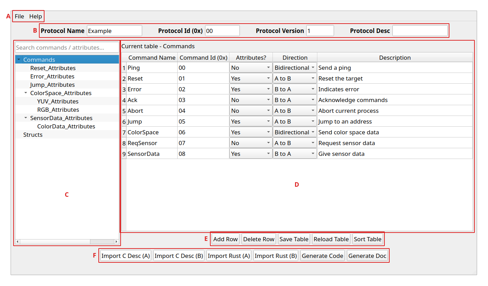
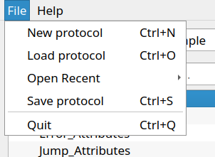
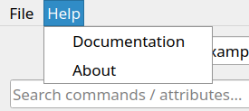

## What is LCSF Generator

LCSF Generator is a C++/Qt graphical tool that will allow you to:
1. Create and edit protocols based on [LCSF](https://jean-roland.github.io/LCSF_Doc/) easily.
2. Generate corresponding code for the [LCSF C Stack](https://github.com/jean-roland/LCSF_C_Stack) and [LCSF Stack Rust](https://github.com/jean-roland/LCSF_Stack_Rust).
3. Import previous protocol source files (C or Rust) to deploy modifications without hassle.
4. Generate protocol documentation in wiki, DokuWiki and markdown format.

## Interface Breakdown

The LCSF Generator GUI is detailed below:

### A - Menu Bar

The menu bar is composed of the file menu and the help menu.

#### File Menu

The file menu structure is:

* New protocol (Ctrl+N): Clear the interface to easily start a new protocol.
* Load protocol (Ctrl+O): Open a file dialog to load a saved protocol.
* Open Recent: Reload one of the last 8 protocols loaded or saved.
* Save protocol (Ctrl+S): Open a file dialog to save the current protocol (json format).
* Quit (Ctrl+Q): Leave the application, it asks whether to save the protocol first.

#### Help Menu

The help menu structure is:

* Documentation: Open a navigator window to this ressource.
* About: Show the software version and a licence abstract.

### B - Protocol Section

This is where you fill the protocol parameters:
* Protocol Name: The protocol name that will be used in files, code and documentation (Up to 64 alphanumerical characters and underscore allowed).
* Protocol Id: The id that will be used in the LCSF stacks to identify the protocol (Up to 4 hexadecimal characters allowed).
* Protocol Version: The protocol version number written in the generated code (0 to 65535).
* Protocol Desc: The protocol description that will be used in documentation.

### C - Table Tree

This component will show hierarchically the different tables that make the protocol.

Clicking on a table will display the table content on the table view (section D).
It will also silently save any modifications on the previous table.

The search bar on top (Ctrl+F) filters the tree by name: a table stays visible when its name, a parent's or a child's name contains the search text.

The tree has two root tables:
* Commands: contains the protocol commands. Each of its children will be a command containing attributes, and each command table child will be an attribute containing sub-attributes and so on and so forth.
* Structs: contains the protocol struct types. Each of its children (`<struct>_Fields`) contains the fields of a struct.

### D - Table View

The table view will display the content of the currently selected table on the table tree (section C).
The label on top indicates which table is currently displayed.

The Commands table displays the protocol command table, the Structs table the struct table, a `<struct>_Fields` table a field table, and any other table an attribute table.

Each row represents an entry in the table.
Each cell of the table can be modified directly, only the name and id columns are mandatory. Greyed cells are computed and read-only.

If the table detects two identical names or ids it will highlight the duplicate cell in yellow.

#### Command Table

The command table is composed of 5 columns:
* Command Name: The name of the command that will be used in code and documentation (Up to 64 alphanumerical characters and underscore allowed).
* Command Id: The id that will be used in the LCSF stacks to identify the command (Up to 4 hexadecimal characters allowed, will be interpreted as 0 otherwise).
* Attributes ?: Does the command have attributes or not (Yes or no choice).
* Direction: Set the command direction (See the LCSF Documentation for more details).
* Description: The command description that will be used in documentation.

#### Attribute Table

The attribute table is composed of 5 columns:
* Attribute Name: The name of the attribute that will be used in code and documentation (Up to 64 alphanumerical characters and underscore allowed).
* Attribute Id: The id that will be used in the LCSF stacks to identify the attribute (Up to 4 hexadecimal characters allowed, will be interpreted as 0 otherwise).
* Optional ?: Is the attribute optional or not (Yes or no choice).
* Data Type: Set the attribute data type (See the LCSF Documentation for more details). Integers and floats are picked by width from the uint, int and float submenus, struct types from the struct (single struct) and struct[] (array of structs) submenus.
* Description: The attribute description that will be used in documentation.

#### Struct Table

Struct types give a byte array attribute an explicit layout, they are defined once and can be used by any attribute. The wire format is detailed in the [README](https://github.com/jean-roland/LCSF_Generator#struct-types).

The struct table is composed of 5 columns:
* Struct Name: The name of the struct that will be used in code and documentation (Up to 64 alphanumerical characters and underscore allowed).
* Extensible?: Can fields be appended to the struct later on without breaking older peers (Yes or no choice). Required for structs with variable-length fields.
* Size (bytes): The struct size on the wire, a maximum when it has variable-length fields (read-only).
* Used By: The attributes using the struct (read-only).
* Description: The struct description that will be used in documentation.

#### Field Table

The field table is composed of 4 columns:
* Field Name: The name of the field that will be used in code and documentation (Up to 64 alphanumerical characters and underscore allowed).
* Data Type: Set the field data type: uint and int from 8 to 64 bits, float 32 or 64 bits, or the variable-length varuint and varint from 16 to 64 bits.
* Offset: The field offset in bytes in the struct, "-" after a variable-length field (read-only).
* Description: The field description that will be used in documentation.

Fields are laid out on the wire in table order.

### E - Table Button

Table buttons have an effect on the table view (section D). It contains 5 buttons:
* Add Row (Insert): Add a new empty row at the end of the current table.
* Delete Row (Del): Delete the currently selected row (the last one by default), modifications will be immediately saved. A struct used by attributes can't be deleted.
* Save Table: Save modifications of the current table, will only take into account valid rows (name and ids are valid).
* Reload Table (F5): Reload the current table and cancel unsaved modifications.
* Sort Table: Sort the table by id ascending order, will also refresh the tree if needed. Struct and field tables keep their order.

### F - Output Button

Output buttons are related to code and documentation generation. It contains 6 buttons:
* Import C Desc (A): Import previous C code of the protocol A point of view (see LCSF directions), it will change the A C output directory to the imported code location. Will turn green after import.
* Import C Desc (B): Import previous C code of the protocol B point of view (see LCSF directions), it will change the B C output directory to the imported code location. Will turn green after import.
* Import Rust (A): Same as Import C Desc (A) for the Rust code.
* Import Rust (B): Same as Import C Desc (B) for the Rust code.
* Generate Code: Generate protocol code for the LCSF C and Rust stacks, it will generate code for both A and B point of views, in `COutput` and `RustOutput` unless code was imported.
* Generate Doc: Generate protocol documentation in the `Export` directory, it will produce wiki, DokuWiki and markdown format of the protocol tables.

### Tooltip

In case you forgot the purpose on an element of the GUI, most of them have a tooltip that might help you.
Just hover your mouse over them for a couple of seconds to make them appear.

## How to use it

1. (optional) Load protocol description.
2. Set/Modify protocol name, id, version and description.
3. (optional) Add/Modify struct types in the Structs table and their fields in the field tables.
4. Add/Modify protocol commands in the Commands table.
5. Add/Modify attributes and sub-attributes in the sub-tables.
6. Save the description for future use.
7. (optional) Import previous code if you already wrote specific code in the protocol main source file.
8. Generate source code and documentation.

## About Code Generation

LCSF Generator will generate code for the LCSF stacks following the protocol description.
It will generate code for both A and B points of view.

It will fully generate the descriptor and bridge files but only build a template for the main files as it cannot produce application code.

If you already wrote application code for the protocol, you can import it through the _Import_ buttons, the code will be included in the next generation. It will only accept files named "protocolName_Main_a.c" or "protocolName_Main_b.c" for C, "protocol_protocolname_a.rs" or "protocol_protocolname_b.rs" for Rust.

## About Code Importation

The code importation feature relies heavily on its internal model of a protocol main source file to extract useful information. This means that heavy modification of this file formatting (sections names mainly) might yield unpredicted behaviour when importing and generating code with it.
